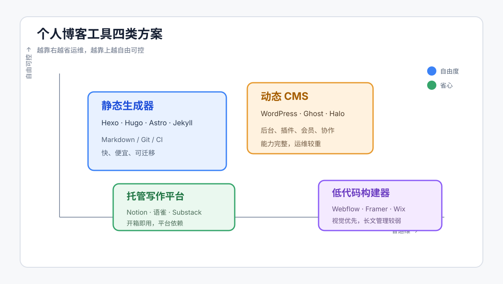
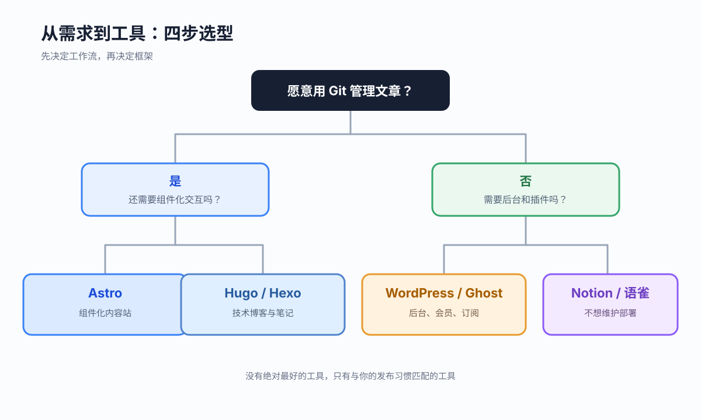

想搭一个个人博客，真正难的通常不是“把页面跑起来”，而是做出一个未来几年仍然愿意维护的选择：文章要不要放在 Git 里？要不要自己管理服务器？主题能不能改？迁移会不会痛苦？评论、搜索、图片和备份又该怎么处理？

这篇文章把目前常见的个人博客方案放在同一张地图上比较，覆盖静态站点生成器、动态 CMS、托管式写作平台和低代码建站工具。结论先说：**技术博客优先考虑 Hugo、Astro 或 Hexo；希望少折腾就选 WordPress 托管、Ghost 或国内的托管平台；如果你最看重写作体验而不是掌控基础设施，直接用 Substack、Notion 或语雀反而更诚实。**



<!--more-->

## 一、先把“博客”拆成五个问题

很多工具对比文章只比较首页长什么样，却忽略了维护成本。选择之前，建议先回答下面五个问题：

1. **内容放在哪里**：Markdown 文件、数据库，还是平台账户里？
2. **谁来负责发布**：自己执行构建和部署，还是点一下发布？
3. **需要多强的表达能力**：代码高亮、数学公式、流程图、全文搜索、评论，哪些是刚需？
4. **你愿意维护什么**：服务器、依赖升级、备份、域名和 HTTPS，能接受到什么程度？
5. **迁移是否重要**：三年后换工具，能否批量导出文章、图片和评论？

一个实用的判断标准是：**把“写一篇文章”到“读者看到文章”之间的步骤数算出来**。步骤越少越容易坚持，但可控性通常也越低。

## 二、四类方案，解决的是不同问题

### 1. 静态站点生成器：性能和可控性的优等生

Hexo、Hugo、Jekyll、Astro、Eleventy 都属于这一类。文章通常以 Markdown 保存，构建时生成 HTML、CSS 和 JavaScript，再部署到 GitHub Pages、Cloudflare Pages、Vercel 或对象存储。

优点是速度快、成本低、攻击面小、内容天然适合 Git 管理；缺点是评论、后台编辑和多人协作需要额外接入服务。对于程序员来说，静态生成器的最大价值不是“免费”，而是**写作和代码可以使用同一套版本控制流程**。

### 2. 动态 CMS：编辑体验和生态更完整

WordPress、Ghost、Halo、Typecho 通过数据库和后台管理文章，通常部署在 VPS、云服务器或官方托管环境中。它们适合需要后台编辑、会员、表单、插件、多人协作的站点。

代价也很明确：要持续更新系统和插件，处理备份、缓存、安全补丁以及数据库迁移。只写个人技术文章时，这些能力很可能变成额外负担；但如果博客未来要变成小型内容站，动态 CMS 会更有扩展空间。

### 3. 托管式写作平台：把精力留给内容

Substack、Medium、Notion、语雀、少数派等平台不要求你管理部署链路。注册、选择模板、开始写作，几分钟就能发布。

它们的交换条件是平台依赖：URL 结构、主题能力、搜索引擎策略和数据导出都受平台限制。适合验证写作习惯、经营订阅关系，或不想处理技术细节的人；不适合作为唯一的长期数字资产仓库，除非你定期导出原始内容。

### 4. 低代码和网站构建器：视觉表达优先

Webflow、Framer、Wix、Squarespace 等工具更像“网站设计工具”，适合摄影、设计、咨询和个人品牌页面。它们能快速做出漂亮的首页与作品集，但长篇技术文章、批量导入和 Git 工作流不是强项。

如果博客的核心是案例展示、服务介绍和邮件收集，构建器很合适；如果核心是几百篇 Markdown 技术笔记，静态生成器的长期效率通常更高。

## 三、主流工具横向对比

| 工具 | 内容方式 | 上手难度 | 性能 | 定制能力 | 运维成本 | 更适合谁 |
| --- | --- | ---: | ---: | ---: | ---: | --- |
| Hexo | Markdown + Node.js | 低 | 高 | 高 | 低 | 已经熟悉前端、想快速发布的人 |
| Hugo | Markdown + Go | 中 | 很高 | 高 | 低 | 文章多、重视构建速度和稳定性的人 |
| Jekyll | Markdown + Ruby | 中 | 高 | 高 | 低 | GitHub Pages 老用户、Ruby 生态用户 |
| Astro | Markdown/MDX + 组件 | 中 | 很高 | 很高 | 低 | 想做内容站并逐步加入交互的人 |
| WordPress | 后台 + 数据库 | 低到中 | 中 | 很高 | 中到高 | 需要插件、后台、会员或多人协作的人 |
| Ghost | 后台 + Markdown | 低到中 | 高 | 中到高 | 中 | 重视订阅、邮件和出版体验的人 |
| Halo / Typecho | 后台 + 数据库 | 中 | 中到高 | 中到高 | 中 | 希望中文后台、自托管 CMS 的人 |
| Notion / 语雀 | 在线编辑器 | 很低 | 取决于平台 | 低 | 很低 | 只想稳定写作、不想碰部署的人 |
| Webflow / Framer | 可视化编辑 | 低 | 高 | 很高 | 低 | 设计展示和个人品牌站 |

这里的“性能”指默认部署下的页面响应和构建效率，不代表所有主题都一样。一个臃肿的主题、未压缩的大图和过多第三方脚本，足以抵消生成器本身的优势。

## 四、Hexo、Hugo、Astro：程序员最常纠结的三选一

### Hexo：最短的上手路径

Hexo 的优势是生态成熟、中文资料多、主题丰富。写一篇文章只需要新建 Markdown 文件，Butterfly、NexT 等主题可以直接提供归档、标签、目录、评论和各种扩展。

它的主要限制是 Node.js 依赖较多，升级时偶尔会遇到插件兼容问题；当文章规模非常大、主题定制很深时，构建链路也会变得复杂。**如果你想今天就把博客上线，并且愿意偶尔维护 npm 依赖，Hexo 仍然是很稳妥的选择。**

### Hugo：把“快”做到极致

Hugo 是单二进制程序，不需要 Node.js 或 Ruby 环境。它的构建速度非常快，适合文章、图片和页面数量较大的站点，也适合在 CI 中频繁构建。

代价是主题和模板体系需要重新学习，遇到问题时中文资料相对少一些。Hugo 的内容模型很清晰，但复杂的交互仍然需要自己写前端组件。

### Astro：内容站和应用的中间地带

Astro 以“默认不发送多余 JavaScript”为卖点，同时允许使用 React、Vue、Svelte 等组件。它很适合从博客起步，未来逐步加入搜索、交互图表、作品集或小型工具。

Astro 的学习曲线高于 Hexo，工程结构也更接近现代前端项目。若你已经在使用 TypeScript 和组件化开发，Astro 的长期上限最高；若只是记录笔记，它可能有些大材小用。

## 五、成本、速度和自由度怎么权衡

### 成本

静态博客可以做到每月 0 元：GitHub Pages 或 Cloudflare Pages 托管，域名按年付费。动态 CMS 至少要承担服务器、数据库和备份成本，托管 WordPress 或 Ghost 则用订阅费用换运维时间。

### 速度

决定速度的不是工具名字，而是生成的页面和资源。选择静态生成器只是第一步，还要压缩图片、延迟加载、减少第三方脚本、使用 CDN，并给字体设置合理的加载策略。

### 自由度

自由度越高，责任越多。自托管 WordPress 可以安装几乎任何插件，但每个插件也可能带来安全和升级风险；Notion 几乎不需要维护，却无法完全控制 HTML、URL 和数据结构。

## 六、我的推荐决策树



可以按下面的顺序快速做决定：

```text
你是否愿意用 Git 管理文章？
├─ 否：是否需要后台、会员或插件？
│  ├─ 是：WordPress / Ghost / Halo
│  └─ 否：Notion / 语雀 / Substack
└─ 是：是否需要组件化交互？
   ├─ 是：Astro
   └─ 否：文章量很大、追求极快构建？
      ├─ 是：Hugo
      └─ 否：Hexo / Jekyll
```

对大多数个人开发者，我会给出三条实际建议：

- **已有 Hexo 博客**：先继续写，不要为了“更现代”而迁移。能稳定发布比换框架更重要。
- **从零开始且偏技术写作**：Hugo 是最省心的长期方案，Astro 是最灵活的成长方案。
- **不想维护技术栈**：选择托管平台，同时每月导出一次 Markdown 或 HTML 备份。

## 七、部署时最容易忽略的细节

1. **把源内容和生成产物分开**：源仓库保存 Markdown、主题和配置，构建产物交给 CI 或 Pages 部署。
2. **图片不要只放在聊天记录里**：统一放进仓库或对象存储，文章中使用稳定的相对路径。
3. **固定 Node.js / Ruby / Go 版本**：在 CI 中声明运行时版本，避免多年后构建突然失败。
4. **保留可迁移格式**：Markdown、Front Matter 和原图是最重要的资产，评论和平台数据要定期导出。
5. **上线后检查三件事**：移动端布局、RSS/站点地图、断链和图片加载。

以当前这个博客为例，Hexo + Butterfly + GitHub Pages 的组合已经覆盖了分类、标签、归档、代码高亮和文章级图片。继续保持 Markdown 写作，并把部署交给 `hexo deploy`，比为了追求工具更新而重建站点更划算。

## 结语：选择能让你持续写下去的工具

博客工具没有绝对的第一名。静态生成器赢在掌控感，动态 CMS 赢在生态，托管平台赢在省心，网站构建器赢在视觉表达。真正决定博客能不能活下去的，通常不是首屏动画，而是**从产生想法到发布文章的阻力够不够小**。

如果你已经有一套能稳定发布的流程，就把时间留给内容；如果还没有，就从最简单的 Markdown + 托管开始，等真实需求出现后再升级。技术选型应该服务于写作，而不是让写作变成维护技术选型的副产品。
