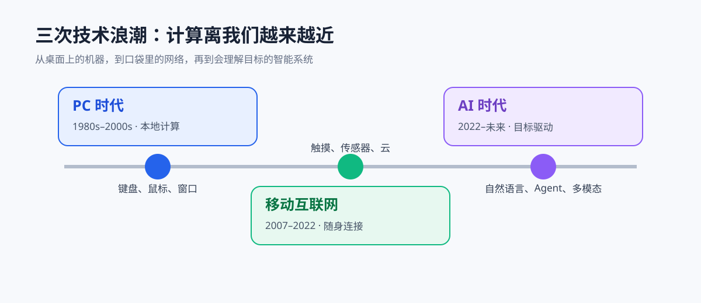
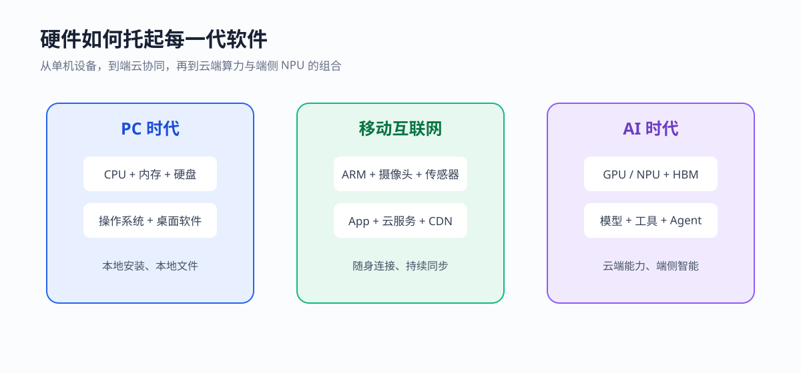
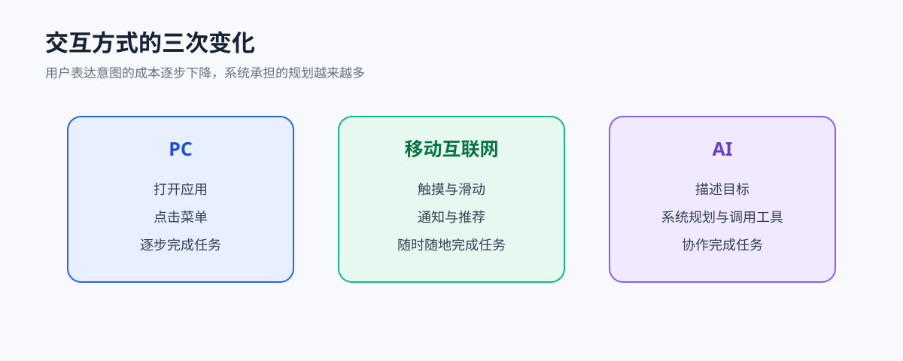

回头看过去三十多年，技术浪潮并不是简单地把设备做得越来越快，而是在不断改变“计算发生在哪里”“我们如何使用软件”以及“普通人能做什么”。PC 时代把计算能力带到桌面，移动互联网时代把网络装进了口袋，AI 时代则开始把理解、生成和行动能力放进每一个软件界面。

这三段历史彼此相连：PC 时代建立了软件和芯片产业，移动互联网把连接、传感器和云基础设施推向大众，AI 时代又站在算力、数据和网络的积累之上。硬件每一次变化，最终都会在交互方式和社会分工上留下痕迹。

<!--more-->

## 一、PC 时代：计算机从实验室走到每张桌子

### 1. 从大型机到个人电脑

早期计算机属于政府、大学和大型企业。大型机昂贵、占地、需要专门人员维护，普通人只能通过终端间接使用计算资源。个人电脑的意义，首先不是“更快”，而是让一个人第一次拥有了完整的输入、计算、存储和输出闭环。

从 1970 年代的微处理器，到 1981 年 IBM PC，再到 1984 年 Macintosh，计算机逐渐形成了今天熟悉的基本形态：显示器、键盘、鼠标、操作系统和应用软件。硬件从分立元件走向高度集成，芯片上的晶体管数量持续增加，价格则逐步下降。

### 2. 软件从工具变成平台

DOS 时代的软件需要记忆命令，图形界面出现后，文件夹、窗口、菜单和鼠标点击成为计算机的共同语言。Windows 和 Mac OS 让更多人能够处理文档、表格、图像和声音，办公软件成为 PC 最重要的生产力应用。

这一时期的软件主要安装在本地，数据也保存在硬盘、软盘或光盘中。升级需要重新安装，协作依赖邮件、局域网和移动存储设备。软件的边界和设备的边界基本重合：电脑上有什么，取决于你安装了什么。

### 3. 互联网把孤立的 PC 连接起来

1990 年代，拨号上网、浏览器和搜索引擎让 PC 从单机工具变成网络入口。门户网站、论坛、电子邮件和即时通信改变了信息传播速度；电子商务则把“在电脑上完成交易”变成日常行为。

宽带普及后，网页从静态文档变成可以登录、评论、支付和协作的应用。服务器开始承担更多计算和存储工作，云计算的雏形也随之出现。PC 仍然是主要终端，但软件已经不再完全属于本地。

### 4. PC 时代留下的基础设施

PC 时代最重要的遗产包括 x86 等通用处理器、操作系统、桌面软件、文件系统、浏览器和互联网协议。今天的云服务器、开发工具和 AI 产品，仍然大量继承着这一时期形成的工程方法：分层、抽象、编译、版本控制和开放标准。

## 二、移动互联网时代：计算从桌面走向身体和环境

### 1. 智能手机重新定义“在线”

功能手机已经能打电话、发短信和上网，但 iPhone 和 Android 把触摸屏、应用商店、摄像头、GPS、陀螺仪和高速移动网络组合成了新的计算平台。手机不再是电脑的缩小版，它拥有随身携带、持续联网和感知环境三种独特能力。

3G、4G 让图片、视频和实时通信变得可行，应用商店则把软件分发从“去网站下载”变成“搜索、安装、更新”。开发者第一次可以面向全球用户发布应用，用户也第一次拥有了一个持续更新的个人软件集合。

### 2. 云服务成为移动体验的后端

移动应用的体验依赖一整套云端系统：账号、消息推送、图片存储、内容推荐、支付、地图和数据分析。手机本身的存储和计算能力有限，但通过 API 调用云服务，它可以完成打车、点餐、直播、协作和内容创作。

这让软件架构发生变化。应用不再是一个孤立的安装包，而是由客户端、服务端、数据库、消息队列和 CDN 共同组成的持续服务。用户看到的是一个按钮，背后可能连接着成百上千台服务器。

### 3. 传感器让软件理解现实世界

摄像头让手机成为最普及的图像采集设备，GPS 让位置成为数据，麦克风和加速度计让声音、运动与环境进入应用。移动互联网的核心变化，是软件开始拥有“现场感”：它知道你在哪里、正在做什么，也能在合适的时间发出提醒。

这种能力带来便利，也带来隐私问题。位置权限、通讯录、照片和行为轨迹都变成了需要认真管理的数据。技术进步不只是功能增加，也要求用户和平台建立更清晰的边界。

### 4. 移动时代的硬件升级路径

智能手机的性能增长集中在几个方向：更高能效的 ARM 芯片、更强的 GPU、更密集的存储、更好的摄像头和更快的无线连接。屏幕从 LCD 走向 OLED，生物识别替代了部分密码，耳机、手表和汽车开始成为手机的外设与延伸。

移动互联网时代的终端不再只有手机。平板、手表、音箱、摄像头和各种 IoT 设备共同组成了一个“多设备环境”。用户的身份、消息和数据在设备之间同步，计算开始从桌面扩散到生活空间。

## 三、AI 时代：软件开始理解、生成并执行

### 1. 从规则系统到大模型

传统软件需要人把规则写清楚，机器按照规则执行。机器学习改变了这种关系：开发者提供数据、目标和训练方法，模型从样本中学习规律。深度学习、GPU、海量数据和 Transformer 架构共同推动了大模型的出现。

大模型的特殊之处在于，它不只完成一个固定任务。经过预训练后，同一个模型可以对话、翻译、总结、写代码、分析图像，再通过工具调用完成搜索、计算和文件操作。软件的入口从按钮和菜单，逐渐扩展到自然语言。

### 2. AI 时代的硬件：算力成为新的基础设施

AI 对硬件的需求和传统应用不同。训练模型需要大量并行计算、显存和高速互联，推理则要求更低延迟、更低成本和更高能效。GPU、AI 加速器、HBM 高带宽内存、先进封装和数据中心网络，成为新的基础设施核心。

与此同时，AI 也在向端侧移动。手机、电脑和汽车上的 NPU 可以在本地完成语音识别、图像处理、摘要和部分生成任务。云端模型提供更强能力，端侧模型提供更好的隐私、速度和离线体验，未来很长时间都会是两者协同。

### 3. 交互从“操作软件”转向“描述目标”

PC 时代，用户打开应用并逐项操作；移动时代，用户通过触摸、滑动和通知与应用互动；AI 时代，用户可以直接描述目标，让系统规划步骤并调用工具。

这并不意味着界面会消失。可靠的 AI 产品仍然需要按钮、表格、预览、权限确认和可撤销操作。变化在于，界面不再是唯一入口，系统可以根据上下文把多个工具组合起来，帮助用户完成跨应用任务。

### 4. AI Agent 与新的软件分工

聊天机器人主要回答问题，AI Agent 则试图把任务做完：读取资料、制定计划、修改文件、执行命令、检查结果，再根据反馈继续行动。软件工程、客服、数据分析和办公自动化都在出现这种工作流。

新的分工正在形成：人负责目标、约束和验收，AI 负责搜索、草拟、执行和迭代。人的价值没有消失，但评价标准从“会不会逐行操作”转向“能否定义问题、判断质量和承担责任”。

## 四、三次浪潮背后的连续性

### 1. 算力从稀缺资源变成普遍能力

PC 时代，计算资源集中在一台桌面机器；移动时代，计算由手机和云端共同承担；AI 时代，算力进一步集中到数据中心，同时通过 NPU 分布到终端。计算的位置不断变化，但底层规律没有变：更高的算力会打开新的软件可能性。

### 2. 数据从文件变成持续的上下文

PC 时代的数据是文件，移动时代的数据变成账号、位置、照片和行为流，AI 时代的数据还要成为模型的上下文。上下文越准确，系统越能理解用户意图；权限、隐私、来源和可追溯性也因此变得更加重要。

### 3. 平台竞争从设备转向生态

PC 时代争夺操作系统和浏览器入口，移动时代争夺应用商店、账号和云服务，AI 时代争夺模型、开发工具、智能体平台和算力供应链。平台的竞争对象变了，但“谁掌握入口，谁就能组织生态”的规律依然存在。

## 五、我们正在进入怎样的 AI 时代

未来几年，最值得关注的可能不是某个单独的模型，而是几条技术线的汇合：更高效的芯片、更便宜的推理、更可靠的 Agent、更自然的多模态交互，以及能够在本地运行的个人 AI。

个人电脑不会消失，手机也不会消失。它们会变成 AI 的载体：电脑适合长上下文和复杂创作，手机适合即时感知和沟通，耳机、眼镜、汽车和家居设备则提供新的环境入口。云端负责规模和能力，端侧负责速度和隐私。

真正值得期待的变化，是技术从“需要学习工具才能使用”逐渐走向“用自己的语言就能调动工具”。但这也要求我们保留工程上的谨慎：重要结论需要验证，敏感数据需要保护，自动执行需要权限边界，模型输出需要可追溯。

## 结语：每一次浪潮，都是一次重新分配

PC 时代重新分配了计算能力，移动互联网时代重新分配了连接与信息，AI 时代正在重新分配理解、创作和执行能力。硬件是浪潮的物理基础，软件是浪潮的组织方式，而真正改变生活的，是人和工具之间新的分工。

回望这三十多年，技术并不是突然从一个时代跳到另一个时代。每一代产品都站在上一代的芯片、协议、数据和经验之上。理解这条连续的演进路径，比追逐某个短暂的热点更重要。
