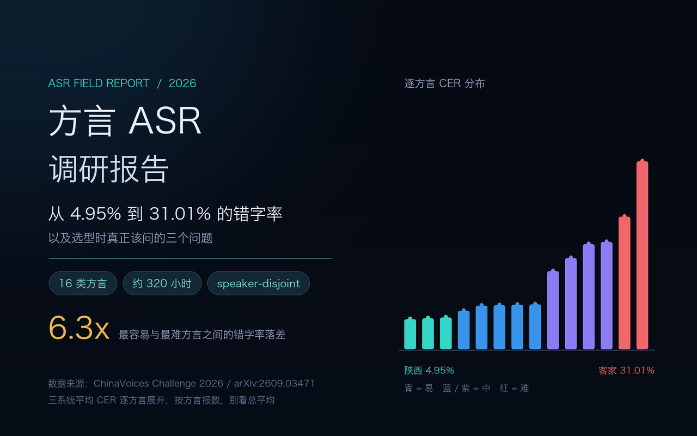
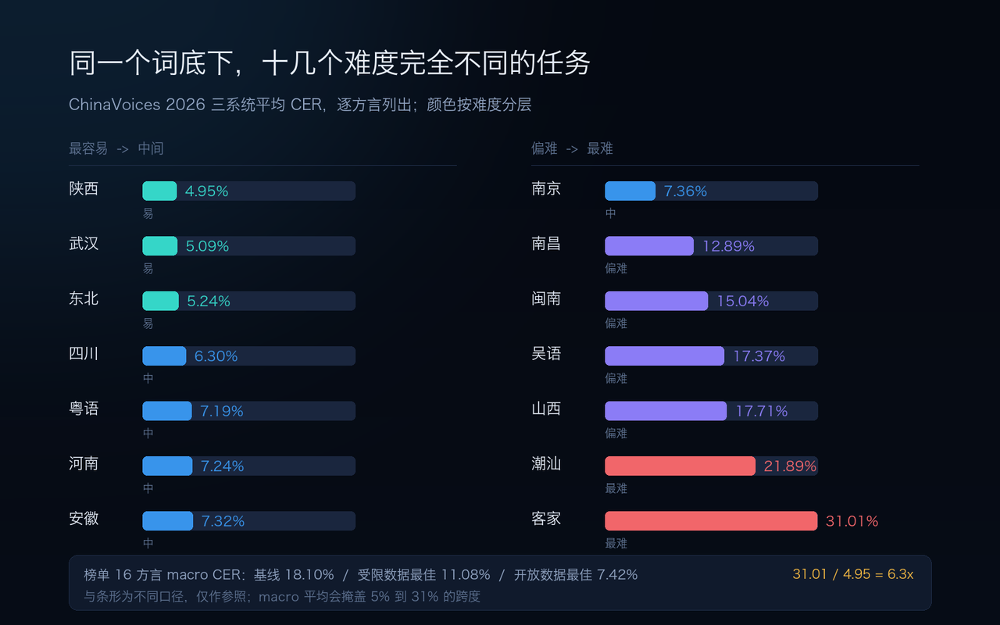
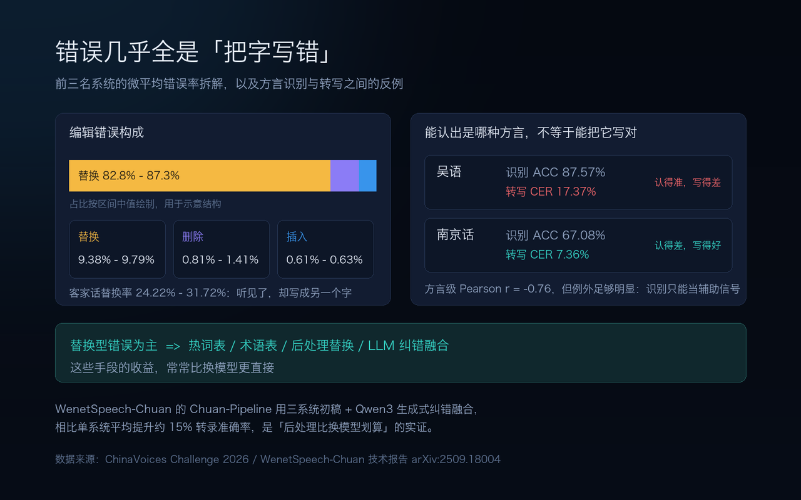
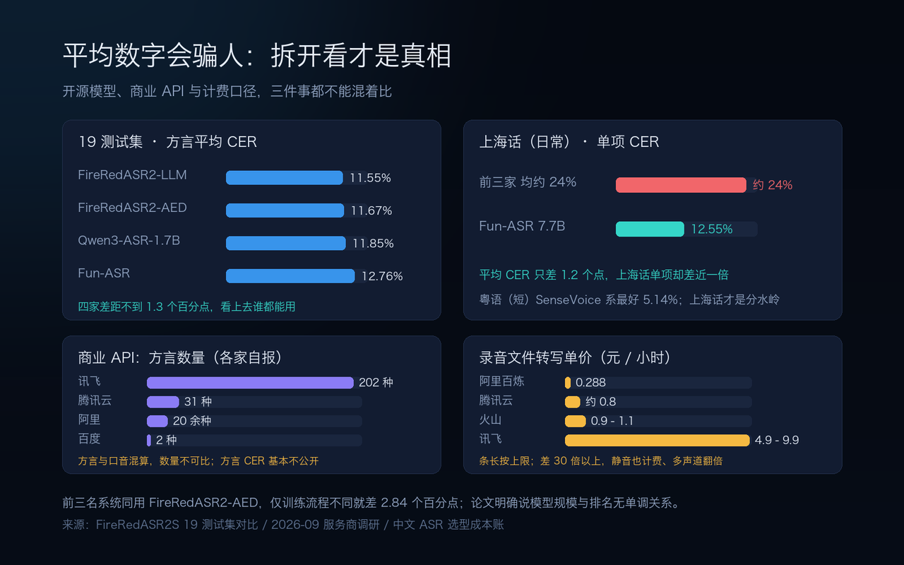
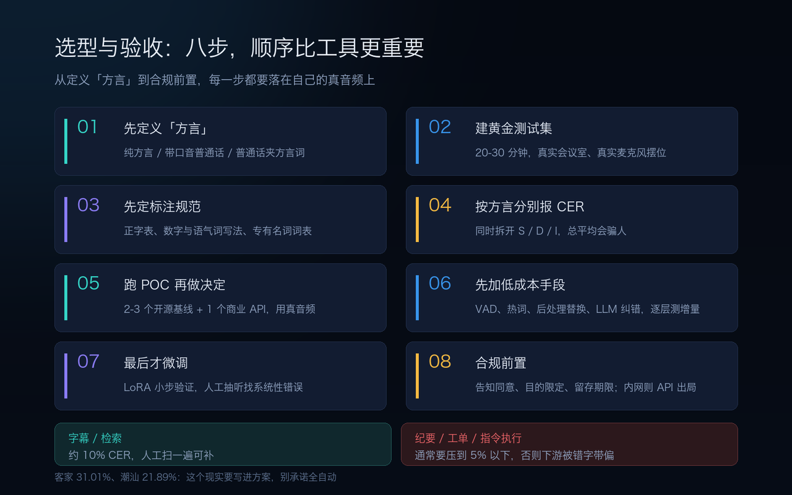

会议室里，一位同事用四川话插了一句，转写稿上变成一串读音相近的普通话字。人听着能猜出原意，检索、纪要、待办抽取全在这句上断掉。

我因为做线下会议录音系统，最近把 2026 年能找到的方言 ASR 资料系统梳理了一遍。越看越觉得，「支持多少种方言」是这个问题里最不重要的一个数字——**同一个模型在不同方言上的错字率能差六倍，而绝大多数选型文章只给你一个平均值**。

这篇是调研报告，不是模型推荐清单。重点放在三件事：差距到底有多大、差距从哪来、以及拿到一套方案该怎么验收。文中的数字我按来源分了层级：**挑战赛/论文**、**厂商自报**、**社区实测**，不混在一起用。

<!--more-->

## 一、先给赶时间的人：五条结论

1. **「方言 ASR」不是一个任务，是十几个难度完全不同的任务。** ChinaVoices Challenge 2026 的官方评测里，最容易的陕西话平均 CER 4.95%、武汉话 5.09%、东北话 5.24%，最难的客家话 **31.01%**、潮汕话 21.89%——差了六倍多。
2. **平均数字没有意义。** 该挑战赛基线（Qwen3-ASR-1.7B + LoRA）的 16 方言 macro CER 是 18.10%，最佳受限数据系统 11.08%，开放数据赛道最佳 7.42%。但 11.08% 这个数背后，是 5% 到 31% 的巨大跨度。**按自己的方言报数，别看总平均。**
3. **模型选型不是第一决定因素。** 前三名系统用的都是同一个 FireRedASR2-AED，只因训练流程不同，彼此差距 2.84 个百分点；论文明确说模型规模与排名**没有单调关系**。
4. **错误几乎全是「把字写错」。** 替换错误占全部编辑错误的 **82.8%–87.3%**，插入只占 5.3%–5.6%。这意味着热词表、术语表、后处理替换的收益，常常比换模型更直接。
5. **商业 API 的「方言数量」不可比，准确率基本不公开。** 讯飞报 202 种、腾讯云 31 种、阿里 20 余种、百度 2 种，但各家统计口径不同（有的算方言，有的把口音也算进去），而且闭源服务几乎不公布方言 CER。选型时只能拿自己的真音频去测。

## 二、差距有多大：把 ChinaVoices 2026 的表摊开

这是目前最值得引用的一份公开评测，因为它的设计足够严谨：16 类方言、约 **320 小时**语音、三个严格 **speaker-disjoint** 的集合（Reference 约 48h / Open Eval 约 112h / Hidden Eval 约 160h），每条都有人工标注并质检过的转写；两个任务（方言识别、多方言 ASR）× 两个数据赛道（受限数据 / 开放数据）共四张榜单；评测集禁止用于训练、微调、伪标签；要求离线推理且**一个主模型处理全部 16 类方言**，不允许堆叠一串单方言模型。

基线是 Qwen3-ASR-1.7B，用 ms-swift 做 LoRA 微调，把「方言标签 + 转写」统一成条件生成任务。成绩是 **53.62% ACC / 18.10% CER**。

| 层级 | 系统 / 场景 | 16 方言 macro CER |
|---|---|---|
| 基线 | Qwen3-ASR-1.7B + LoRA | 18.10% |
| 受限数据赛道 | 第 1 名 TeleASR（Hidden 集 10.70%） | **11.08%** |
| 受限数据赛道 | 第 2 / 3 名 | 11.22% / 11.75% |
| 开放数据赛道 | 最佳（允许自有数据） | **7.42%** |

注意这是 **macro 平均**——16 类方言等权，避免大语种主导。所以「11.08%」不代表你随便挑一个方言就有这个水平：

| 难度 | 方言 | 三系统平均 CER |
|---|---|---|
| 最容易 | 陕西 / 武汉 / 东北 | 4.95% / 5.09% / 5.24% |
| 中间 | 四川 6.30%、粤语 7.19%、河南 7.24%、安徽 7.32% | 6%–8% |
| 偏难 | 南昌 12.89%、闽南 15.04%、吴语 17.37% | 13%–18% |
| 最难 | 山西 17.71%、潮汕 21.89%、**客家 31.01%** | 18%–31% |

错误构成更能说明问题。前三名系统的微平均错误率：替换 9.38%–9.79%、删除 0.81%–1.41%、插入 0.61%–0.63%。**替换占全部编辑错误的 82.8%–87.3%**，客家话的替换率高达 24.22%–31.72%。也就是说，模型不是「听不见」，是听见了却写成了另一个字——方言词汇和发音的覆盖不足，而不是声学信号丢失。

还有一个容易踩的认知坑：**能认出是哪种方言，不等于能把它写对。** 两个任务的方言级成绩强负相关（Pearson r = −0.76），但例外很明显——吴语识别准确率 87.57%，转写 CER 却 17.37%；南京话识别只有 67.08%，CER 反而只有 7.36%。论文的建议是把方言识别当作辅助信号，不能替代直接测转写。

## 三、差距从哪来：四层根因

**第一层：数据不是少，是不均衡。** 近两年开源方言语料其实进展很快：WenetSpeech-Yue 约 **21,800 小时**粤语（10 个领域、多维标注）、WenetSpeech-Chuan **10,013 小时**川渝方言（9 个领域，其中置信度 >0.9 的强标签 3,714 小时）、WenetSpeech-Wu 吴语，以及 KeSpeech（1,396 小时训练集，含八种官话口音子集）。但客家、潮汕、闽南这类方言仍缺大规模语料—— ChinaVoices 每类才约 20 小时，这个量级下模型只能靠迁移。

**第二层：很多方言没有标准正字，这是最容易被忽略的一层。** CER 的分母是「标准答案」，可如果标准答案本身不唯一，这个指标就测不准。这个问题在方言 ASR 研究里被反复讨论：MGB-3 挑战赛里四位标注者自由拼写埃及阿拉伯语，即便归一化了三个易混字母，词级分歧仍有约 **13%**；有研究发现标为粤语的数据集 `yue_hk` 几乎全是标准书面汉语而非粤语口语；台湾闽南语则同时存在全汉字、罗马化（Tâi-lô）与混合写法，数据集中每条同时给两种形式，而说话人往往只读其中一种，造成对齐错乱。

落到工程上有两条可操作的做法：**先定正字规范与项目词表**，再谈模型；转写保留 verbatim 主层（重复、语气词、断裂都标），干净层用规则派生，因为反过来无法恢复。研究也提示了另一条思路——把方言音频直接对齐到有标准书写的「锚语言」文本（如瑞士德语→标准德语的 pivot 方案），绕开不稳定的中间转写。

**第三层：词汇与发音覆盖。** ChinaVoices 的结论很直接：改善困难方言要靠 lexical and pronunciation coverage、难方言过采样、辅助声学–文本对齐、跨语料文本归一化，而不是「uniform increase in training samples」（平均地多喂数据）。混淆方向也不对称——长沙话被认成武汉话 18.55%，反向只有 6.34%；南京话认成安徽话 14.86%，反向 5.26%。这说明误差里混着类内差异和样本覆盖问题，不只是「方言长得像」。

**第四层：场景条件。** 一份闽南语小样本 POC（**社区实测，非官方基准**）给出的参考区间是：Qwen3-ASR-0.6B 安静场景约 6%、噪声约 12%、长句约 9%；SenseVoice 安静约 9%、噪声约 16%；Whisper large-v3 安静约 22%、噪声约 30%，且常把整句转成普通话或输出方言字乱码。这组数字绝对值不必当真，但**同一模型安静到噪声翻倍**这个趋势，和做会议录音的经验一致：远场、混响、抢话、多人交叠叠加上方言，公开基准里几乎空白。

顺带说一句，Whisper 在中文方言上普遍不推荐当主力。我之前做私有化录音系统选型时也测过，中文 CER 19.11% 对 5.88% 的差距，加上依赖体积，最后走了 sherpa-onnx 这类轻量方案——方言场景只会把这个差距放得更大。

## 四、方案全景：开源模型、商业 API、自建

### 开源模型（可私有化）

| 模型 | 方言能力（厂商/项目自报） | 注意点 |
|---|---|---|
| FireRedASR2（AED / LLM） | 20+ 种，中文公开基准领先 | ChinaVoices 前三名都以 AED 版为底座；19 个方言测试集平均 CER 约 11.55% |
| Qwen3-ASR（0.6B / 1.7B） | 官方口径 30 种语言 + 22 种方言 | 0.6B 适合高吞吐分流；挑战赛基线用 1.7B + LoRA 得 18.10% CER |
| Fun-ASR-Nano（800M） | 7 方言 + 26 种地方口音 | 7.7B 版未开源，别把两者成绩混用 |
| SenseVoice-Small | 粤语明显优于 Whisper | 可 GGUF / 单二进制 CPU 跑，边缘端友好；需自接 VAD |
| Dolphin-CN-Dialect（0.4B） | 21 类方言平均 CER **5.74%**（项目自报） | 中文字符级建模、18,173 词表、预留 80 个方言 token；参数效率高，但需自行复现验证 |
| Paraformer-zh | 普通话为主 | 方言平均 CER 22.76%（作为对照基线） |
| Whisper large-v3 | 多语种 | 中文方言明显偏弱，适合当参照基线，不建议主力 |

**没有一个模型在所有方言上赢。** FireRedASR2S 仓库的 19 测试集对比里，方言平均 CER：FireRedASR2-LLM 11.55%、AED 11.67%、Qwen3-ASR-1.7B 11.85%、Fun-ASR 12.76%——看着差不大，但拆开看：粤语（短）SenseVoice 系最好 5.14%，上海话（日常）前三家都在 24% 上下，**只有 Fun-ASR 7.7B 做到 12.55%**。上海话这一项差不多就是「能不能商用」的分水岭。

### 商业 API（覆盖广但准确率不透明）

一份 2026 年 9 月的服务商调研给的口径：讯飞 **202 种**方言（宣称覆盖 288 个地级市）、腾讯云 **31 种**（大模型 2.0 引擎）、阿里 20 余种、百度仅粤语 + 四川话；腾讯混元 Hy-ASR-3.0-preview 则主打粤语、东北话、河南话、陕西话、成都话等。价格跨度极大：录音文件转写从阿里百炼 Paraformer **0.288 元/小时**，到腾讯约 0.8 元、火山约 0.9–1.1 元、讯飞语音转写 4.9–9.9 元/小时，**差 30 倍以上**；实时识别普遍 1.2–3.5 元/小时。

⚠️ 两个必须提醒的口径问题：一是「方言数量」各家自报，方言与口音混算，202 vs 31 不能直接比较；二是**闭源 API 的方言 CER 基本不公开**，厂商通常只说「满足商用场景」。阿里云甚至存在宣传页写「20 余种」、第三方实测写「仅粤语、四川话」的矛盾说法。

对做会议录音的人，计费陷阱比单价更要命：

- **静音也计费**——先用 VAD 切掉再送识别，长会议能省 30% 左右；
- **16K 多声道按「声道数 × 时长」计费**（阿里口径），双人分轨录音直接翻倍，8K 双声道反而按单声道算；
- 腾讯梯度按**每日**用量结算而非按月，批处理攒一天跑和分摊跑能差 2.7 倍；
- 讯飞的方言/语种能力要在控制台单独购买，不含在基础套餐；
- 百度小时包一年有效，用不完作废。

### 自建 / 微调（数据不出内网）

这是私有化场景唯一可走的路。收益比想象中大，且主要来自数据而非模型：

- WenetSpeech-Chuan 论文：用该数据集微调 Paraformer 和 Qwen2.5-omni，整体性能分别提升 **11.7%** 与 **11.02%**；再加 1,000 小时高质量内部方言数据，Paraformer 平均 CER 降到 **13.38%**，且不影响普通话表现。
- 该数据集的 Chuan-Pipeline 用三个 ASR 系统（FireRed-ASR、SenseVoice-Small、TeleASR）出初稿，再让 Qwen3 做生成式纠错融合（LLM-GER），相比单系统平均提升约 **15%** 转录准确率。这是「后处理比换模型更划算」的一个实证。
- LoRA 微调用得很普遍：r=8 起步，与普通话差异大的方言（闽南语、客家话）可提到 16/32；学习率 1e-4~5e-4 配余弦退火，梯度裁剪 1.0；配 SpecAugment 与早停防过拟合。社区有 2 小时上海话把 WER 从 12.7% 降到 6.3% 的实测（**个人 POC，仅示意**）。
- 数据质量是天花板：音频与文本严格对齐、说话人年龄/性别/语速多样、**训练/验证/测试的说话人不重叠**、错标文本会被小样本放大。

ChinaVoices 的系统层结论可以作为这一节的注脚：前三名同用 FireRedASR2-AED，差别全在训练细节——跨语料转写归一化与对齐、上下文拼接、速度扰动与噪声注入、难方言过采样、分层学习率、联合 AED–CTC、辅助 CTC。**先把数据处理和解码策略抠到位，再考虑换底座。**

## 五、一份可执行的选型与验收流程

结合我自己做线下录音系统的经验，把调研结论收成八步：

- [ ] **先定义「方言」**：是纯方言、带口音的普通话，还是普通话里夹方言词（code-switching）？这三者需要的数据集、正字规范和模型都不同。
- [ ] **建自己的黄金测试集**：20–30 分钟就够，但必须是真实会议室、真实麦克风摆位，覆盖安静 / 噪声 / 远场 / 抢话，人工精标，说话人与后续训练数据不重叠。
- [ ] **先定标注规范再标数据**：正字表、数字与语气词写法、专有名词词表；保留 verbatim 主层。
- [ ] **按方言分别报 CER，并拆开 S/D/I**：总平均会骗人；替换率高就优先上热词与后处理替换表。
- [ ] **跑 2–3 个开源基线 + 1 个商业 API 做 POC**，商业的一定用真音频，不看宣传页的方言数量。
- [ ] **先加低成本手段**：VAD 切分、热词 / 术语表、后处理替换、LLM 纠错融合，每加一层测一次增量。
- [ ] **最后才微调**：LoRA 小步验证，先跑 1–2 个 epoch 看 loss 曲线，人工抽听验证集找系统性错误（比如某一类声调总错）。
- [ ] **合规前置**：方言语音同样属于个人信息，告知同意、目的限定、留存期限要先定；数据不出内网时，商业 API 直接出局。

关于验收线，给一个经验锚（不是行业标准，按业务自调）：**做字幕、做检索，10% 左右的 CER 尚可通过人工扫一遍补上；做纪要、工单、指令执行，通常要压到 5% 以下**，否则下游的摘要和待办抽取会被错字带偏。客家话、潮汕话目前公开最佳都在 20%–31%，这个现实要提前写进方案，别承诺「全自动」。

## 六、还有哪些没解决

诚实列一下，避免这份报告显得什么都解决了：

1. **无标准正字方言的 CER 可比性**——不同项目用不同正字规范，跨论文的数字严格来说不能直接比。
2. **商业 API 的方言准确率黑盒**——覆盖数量可查，准确率查不到，只能自己测。
3. **语码混用缺基准**——真实会议里最常见的「普通话 + 方言词」，公开评测集几乎没有专门设计。
4. **远场多人 + 方言叠加**——公开基准多是单人近讲或干净音频，与会议室场景差距明显。
5. **数据合规与方言保护**——方言采集往往涉及特定地域人群，授权、留存、偏见评估都要前置；这也是私有化部署常被忽略的隐性成本。

## 结语

调研下来最有用的收获，不是「哪个模型第一」，而是搞清楚了**「方言 ASR」这个词底下藏着十几个难度完全不同的任务**。陕西话 4.95% 和客家话 31.01% 之间，隔的不是一代模型，是数据、正字规范和声学覆盖的一整套差距。

所以选型时真正该问的不是「支持多少种方言」，而是三个更朴素的问题：**我要处理的是哪一种、我的真实录音环境有多差、我能容忍每百字错几个。** 把这三件事写清楚，榜单上的数字才有意义。

这和前面几篇的结论其实一致：模型负责把活干完，人负责确认这活干对了。方言只是把这道质检的必要性放得更大了一点。

---

**资料来源**

- [ChinaVoices Challenge 2026: Data, Tasks, Baseline, and Methods（arXiv:2609.03471）](https://arxiv.org/html/2609.03471v1) — 本文第二节与大部分 CER 数据的出处
- [WenetSpeech-Chuan：1 万小时川渝方言语料库与 WSC-Eval](http://mp.weixin.qq.com/s?__biz=MzA3NTQzNzM1Ng==&mid=2648431664&idx=1&sn=359ae6fff52633923606f26160c17801) / [技术报告 arXiv:2509.18004](https://arxiv.org/abs/2509.18004)
- [WenetSpeech-Yue / Chuan / Wu 数据集与评测基准说明](https://agent.csdn.net/6a7e926f662f9a54cb9c959d.html)
- [中文语音识别该用谁：6 个开源模型对比（含 FireRedASR2S 方言表）](https://juejin.cn/post/7618896648213102632)
- [Dolphin-CN-Dialect 发布说明（21 类方言评测）](https://gitcode.csdn.net/6a04426754b52172bc73c45d.html)
- [方言语音识别服务商调研：能力与价格（2026-09）](http://mp.weixin.qq.com/s?__biz=MjM5MTQ3OTY5Mg==&mid=2651473002&idx=1&sn=c2f6b041785acf57ea8417d7ad16a8e2)
- [中文语音识别选型 2026：成本账与计费陷阱](https://blog.csdn.net/qq_31429225/article/details/163707259)
- [多语言语音数据集中的数据质量问题（正字法与粤语/闽南语案例分析）](https://www.alphaxiv.org/zh/overview/2506.17525v2)
- [Arabic Transcription Guidelines for ASR: Dialects, Code-Switching & Tags](https://www.bayanatlabs.com/insights/arabic-transcription-guidelines)
- [TeleSpeech-ASR：星辰超多方言模型与 KeSpeech 各方言 CER](http://guthub.com/baixu0818/TeleSpeech-ASR)
- [腾讯云混元大模型产品页（Hy-ASR 方言支持）](https://cloud.tencent.com/product/tclm)
