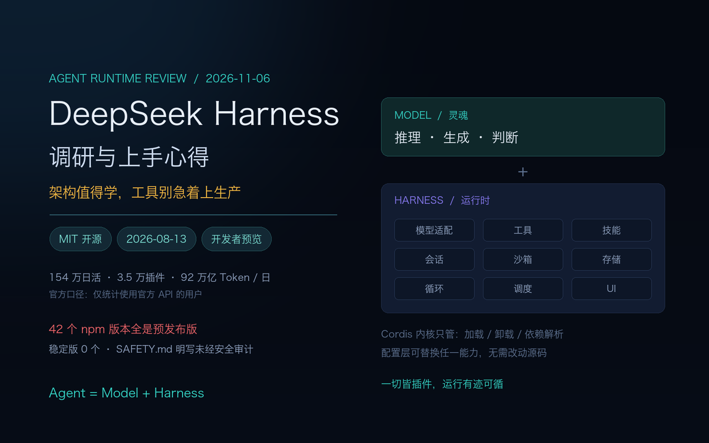
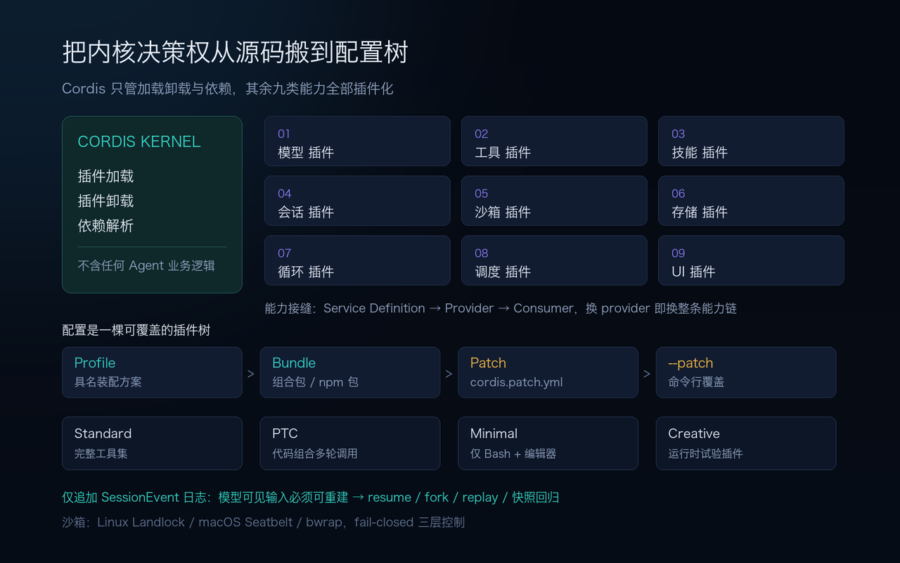
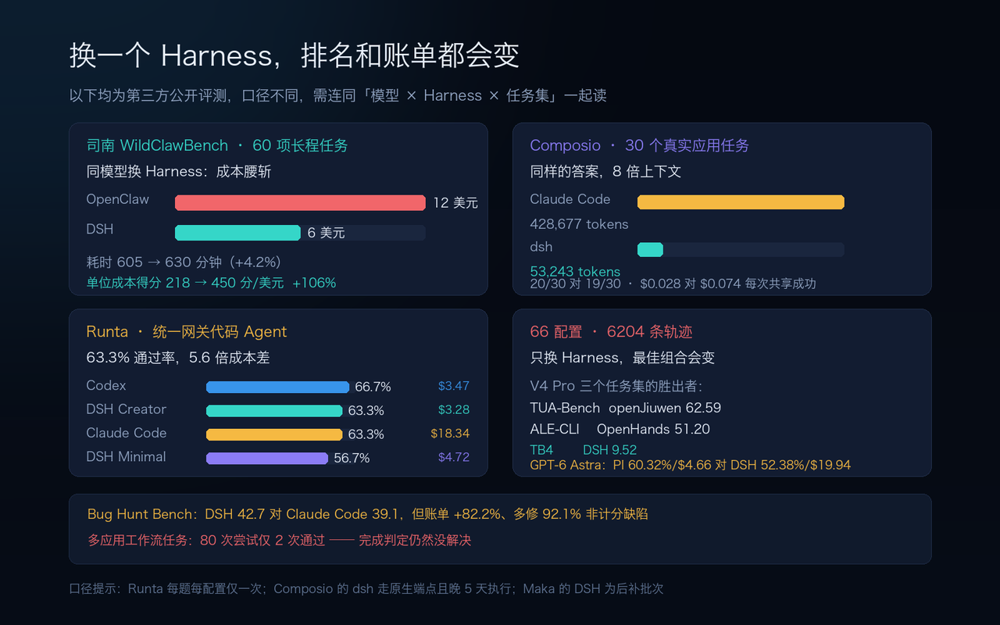
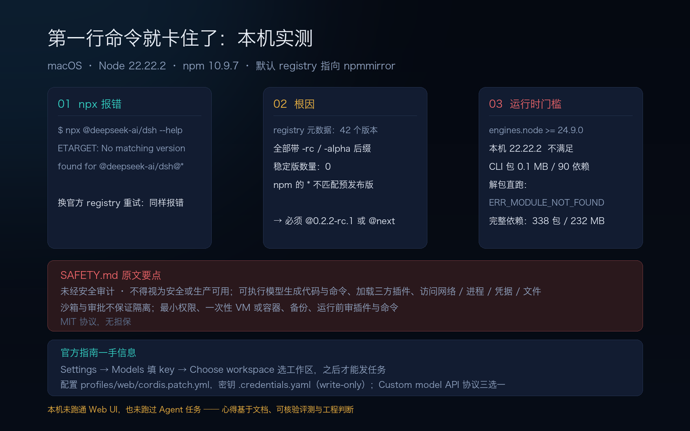
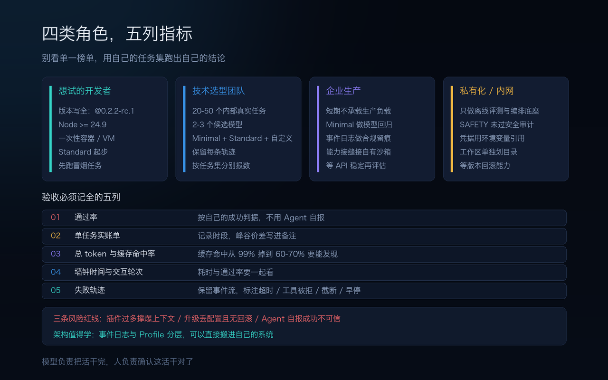

先说结论：DeepSeek Harness（下称 DSH）最值得学的不是「一切皆插件」这句口号，而是它把 Agent 的内核决策权从源码搬到了配置树，并且让**模型看得到的输入可以从日志完整重建**。这两件事对做工程的人比对刷榜的人有用得多。

但另一个结论同样明确：**它现在不该进生产**。官方 SAFETY.md 自己写着「未经安全审计、不得视为安全或生产可用」；我在本机照官方 README 敲第一行命令就卡住了，一路查下来发现的是整个项目当前状态的缩影——42 个 npm 版本全是预发布版，零个稳定版。

这篇分两部分：前半是调研分析，后半是上手实测与使用心得。数字我按来源分了层级：**官方一手**、**第三方评测**、**社区实测**、**本机实测**，不混着用。尤其要提醒一句：Agent 领域几乎所有分数都是「模型 × Harness × 任务集」共同作用的结果，脱离这三要素谈「谁更强」没有意义。

<!--more-->



## 一、先厘清：Harness 不是模型，也不是评测框架

「Harness」这个词在 LLM 语境里至少指两样东西，混了会闹笑话：

| 概念 | 干什么的 | 典型例子 |
|---|---|---|
| **Agent Harness（运行时）** | 包在模型外面，负责 Agent 循环、工具调用、上下文管理、会话状态、失败恢复、权限与沙箱 | DSH、Claude Code、OpenHands、Codex |
| **Evaluation Harness（评测框架）** | 提供测试集、打分器、重复运行与报告 | lm-evaluation-harness |

DSH 是前者。官方给的等式很干净：**Agent = Model + Harness**——模型是「灵魂」，Harness 让 Agent 能理解环境、使用工具、在真实场景里持续工作。换个更工程师的说法：模型负责推理，Harness 负责把推理变成可交付的动作，并决定什么时候算「做完了」。

几个基本事实（官方一手 + 公开报道）：

- 2026 年 8 月 13 日以 **MIT 协议**开源，v0.1 开发者预览版；底层是 **Cordis** 插件系统，设计参考论文 *A Programming Paradigm for Spatiotemporal Composability*。
- 专项团队独立于模型团队运作，负责人崔添翼；最初方向被描述为对标 Claude Code 的「DeepSeek Code Harness」。
- 截至 11 月 4 日，按**使用官方 API 的用户**统计：日活 **154 万**、日消耗 Token 约 **92 万亿**、第三方插件约 **3.5 万个**、约 **60%** 的活跃用户制作或安装过至少一个第三方插件。这是官方口径，只覆盖官方 API 用户，别当成全量用户数。
- 10 月 31 日团队发过一篇《Super-agent 设计探索》，想解决的是 Agent 与「单次手动会话」解绑，成为能跨会话保持上下文、并行推进多项任务的连续实体。

一个容易忽略的定位差异：**DSH 不是面向普通用户的开箱即用产品，而是开发者工具与基础设施**。它把模型、工具、界面甚至内置功能的选择权都交给使用者，连内置功能都允许第三方插件替换。这既是它最大的吸引力，也是后面所有麻烦的源头。

## 二、架构：把内核决策权从源码搬到配置树



### 微内核与「一切皆插件」

Cordis 元框架只做三件事：**插件加载、插件卸载、依赖解析**，不含任何 Agent 业务逻辑。模型适配器、工具、技能、会话、沙箱、存储、Agent 主循环、调度、UI 全是独立插件，通过 Cordis 的**服务（Service）与事件（Event）**协作，在配置层自由组合。

这带来两个别的框架少有同时具备的性质：

- **时间可组合**：插件注册的副作用是可逆的，卸载时完整回滚，所以敢在运行时动态装卸，不需要「打补丁的特权内核」。
- **空间可组合**：依赖关系可随配置变化动态重建。

更有意思的是**能力接缝（Capability Seam）**：每项能力拆成固定三角色——`Service Definition`（稳定接口）→ `Service Provider`（具体实现）→ `Consumer`（通常是面向模型的工具）。消费者不知道背后挂的是谁。所以把 filesystem 与 process 两个 provider 同时指向远程沙箱，Bash、PTY、LSP 会一起迁移，不必为每个工具单独 fork。

### 配置是一棵可覆盖的插件树

运行中的 DSH 是一棵插件树，启动时按层叠加（来自 npm 包内中文 README 与官方架构文档）：

| 层 | 作用 |
|---|---|
| **Profile** | Harness home 里的具名装配方案，记录叠加哪些 bundle、树外插件、用户的 `cordis.patch.yml` |
| **Bundle** | Cordis 配置项及其挂载代码的分发格式（npm 包），如 `dsh-base`、`dsh-web-app`、`dsh-headless` |
| **Patch** | 覆盖层，按行 ID 插入、替换或删除插件树条目，后层生效 |

叠加顺序是：profile 的各 bundle → profile 的 `cordis.patch.yml` → home 级 patch → 命令行 `--patch`。`dsh --profile web --dump-config` 可以**不启动**、直接打印本机实际会启动的配置树，任何一行都能被自己的 patch 替换。官方内置 `web`、`headless`、`tui` 等 profile；`dsh --profile acp` 走 ACP stdio，`dsh --profile headless "job"` 跑一次性任务。

我读包内 README 时最欣赏的一句是：**SDK 与 ACP 都是 profile，而不是独立的公开可执行命令**。也就是说，「同一套运行时驱动 Web UI、ACP 自动化服务、无头 CLI」不是三份代码，是三套插件装配方案。这才是「平台」和「工具」的分界。

### 四种模式与事件溯源日志

| 模式 | 默认加载 | 用途 |
|---|---|---|
| **Standard** | 完整工具集：文件编辑、Shell、检索、Skills、计划、子 Agent、工作流 | 通用任务 |
| **PTC** | 在 Standard 之上，用模型生成的一段 TypeScript 程序组合多轮工具调用 | 批量、结构化任务，减少往返 |
| **Minimal** | 仅一个持久 Bash + 一个 `str_replace_editor` | **最小环境下的模型基准测试** |
| **Creative** | 检查运行时、在内存中试插件、组合新 preset | 原型与插件开发 |

模式切换本质是加载不同插件集合，不是四套代码。

会话日志是架构里信息量最高的一层：它不是消息数组，而是**带类型的、仅追加的 SessionEvent 日志**，是 Agent 全部交互历史的唯一事实来源。系统提示词、思维链、工具调用与结果、子 Agent 派发、每一次上下文注入都写进去；`session/event` 存持久事实，`agent/*` 负责运行时协调，`fs/* · tools/* · telemetry/*` 承载能力与策略。官方运行时不变式是：**模型看得到的输入必须能从会话日志重建**——所以 resume、fork、检索、回放、Trajectory 视图、快照回归测试都收敛到同一条事件流。

安全侧：跨平台沙箱（Linux Landlock、macOS Seatbelt、bwrap）、分层文件权限、fail-closed 设计、权限 + 审批 + 沙箱三层控制；异构子 Agent 走 ACP 与 dsh-sdk，还能把 Claude Code / Codex 当子 Agent 接进来；模型侧支持 DeepSeek 原生及 Anthropic、OpenAI、Bedrock、Gemini、Kimi 等 40 多家 provider。

## 三、数字：换一个 Harness，排名和账单都会变



这一节的所有数字都要连同「模型 × Harness × 任务集」一起读。我先给最反直觉的一条：**在 66 种配置、6204 条计分轨迹的研究里，只换 Harness 就能把同一个模型的排名翻过来**（arXiv:2610.00917）。

**表 1：几份口径不同的第三方评测（均为公开报告，非我实测）**

| 评测 | 设置 | 关键结果 |
|---|---|---|
| 司南 WildClawBench | 60 项真实长程任务，Score / Cost / Time 三维 | V4 Pro + DSH 得 **45.0**，7 个价格稳定的 DSH 配置排第 3；定性「中上能力、低成本、较高耗时」。GPT-5.4 + DSH 最佳 **53.8**、$0.30/任务、3.98 分钟 |
| 同模型换 Harness 对照 | 同上，V4 Pro 配 OpenClaw vs DSH | 成本 **6 vs 12 美元**（-50%），耗时 630 vs 605 分钟（+4.2%），单位成本得分 **218 → 450 分/美元（+106%）** |
| Composio 30 任务 | 统一 V4 Pro 0813、6 个 harness、900 秒上限、10 类真实应用 | DSH `0.1.0-rc.7` **20/30**、88,562 tokens/任务、14.2 次工具调用、$0.028 每次共享成功；Claude Code 19/30、649,900 tokens、11.7 次、$0.074 |
| Runta 代码 Agent | 第三方统一网关、Kimi K3、每题每配置仅一次 | Codex 66.7%/$3.47；**DSH Creator 63.3%/$3.28**；Claude Code 63.3%/$18.34；DSH Standard 60.0%/$3.46；DSH Minimal 56.7%/$4.72 |
| Bug Hunt Bench | 105 个隐藏 bug、两个生产代码库、离线、抹 Git 历史、盲评 | Max 档 DSH **42.7** vs Claude Code 39.1；代价是单任务账单 $1.01 → **$1.84（+82.2%）**，另多修 92.1% 的非计分历史缺陷 |
| Maka Terminal-Bench 2.1 | 89 题、统一 V4 Flash、9 个 harness | Codex 82.0% > Pi 74.2% > **DSH 73.0%** > Claude Code 55.1% |

**三条我认为最值得带走的结论：**

1. **成本优势是真的，但来自调度效率，不是模型变强了。** Composio 里那个 PostHog 聚合案例最能说明问题：两个 harness 都通过全部 8 项检查，Claude Code 用了 428,677 tokens，dsh 只用 53,243——**同样的模型、同样的答案，8 倍的上下文**。而且 Claude Code 工具调用次数更少（11.7 vs 14.2），所以不是「干得更多」，是每一步都背着更重的上下文。作者还指出 Claude Code 的缓存经济性依赖 Anthropic 自家的 `cache_control` 断点，换到第三方网关上这套机制就不跟着走了。
2. **Harness 不是对谁都免费加成。** 66 配置研究里，V4 Pro 在 Terminal-Bench 4 上 DSH 得 9.52（四种 harness 最高），但 TUA-Bench 上只有 51.93（垫底之一），ALE-CLI 上 40.94 也是最低。GPT-6 Astra 在 Terminal-Bench 4 上用 PI 得 60.32%、单任务模型成本 $4.66，用 DSH 是 52.38%、$19.94——PI 走 2560 次模型调用 / 1.1 亿未缓存输入 token，DSH 走 11879 次 / 6.73 亿。司南报告里 GLM 5、MiniMax M2.7 配 DSH 也没有明确综合优势。
3. **「降本」和「攻坚」是两种相反的用法，别混着谈。** 司南的同模型对照是成本 -50%、耗时 +4.2%；Bug Hunt Bench 则是多花 82% 的钱换 +3.6 分和翻倍的非计分修复量，原因是 DSH 默认开 Subagents、跑在全权限模式，遇到硬 bug 会派生子任务、反复重试，而 Claude Code 走克制、单线程、保守早停的路线。同一个工具，Profile 不同，账单结构完全不同。

**必须标出的口径局限**：Composio 那组里 dsh 走 DeepSeek 原生端点、其余五个走 OpenRouter，且比其他 arm 晚 5 天执行；Claude Code 有 2 次超时没留下用量记录，只按 28 题计量；作者说只有基于 14 个共享成功任务的 paired 成本指标算得上干净。Runta 每题每配置只跑一次。Maka 的 DSH 是在原批次之后、基础设施修复后重跑的。评测里按的 `$0.14/$0.28` 也已是历史价——V4 Flash 从 8 月 16 日起改峰谷计费，off-peak $0.22/$0.66 per MTok、peak $0.44/$1.32。

还有个数字值得单独记：Composio 测试集里 10 个「像同事随口交代、没有 schema、没有成功契约」的多应用工作流任务，跨所有测过的 harness、两个模型、两轮运行，**总共 80 次只过了 2 次**。作者的评语是「Nobody has solved that yet」。这比任何榜首分数都更能说明当前 Agent 的真实边界。

## 四、上手实测：第一行命令就卡住了



这一节全是**本机实测**，环境：macOS、Node **v22.22.2**、npm **10.9.7**、默认 registry 指向 `https://registry.npmmirror.com/`。我把过程写下来，因为它比任何宣传页都更能说明「开发者预览版」这五个字的分量。

**第一步，照官方 README 敲：**

```bash
npx -y @deepseek-ai/dsh --help
# npm error code ETARGET
# npm error notarget No matching version found for @deepseek-ai/dsh@*.
```

我起初以为是国内镜像同步滞后，于是显式指定官方 registry：

```bash
npx -y --registry=https://registry.npmjs.org @deepseek-ai/dsh --help
# 同样的 ETARGET
```

**查 registry 元数据找到了真正原因**：`@deepseek-ai/dsh` 一共发布过 **42 个版本**，从 `0.0.1-rc.1` 到最新的 `0.2.2-rc.1`，**全部带 `-rc` 或 `-alpha` 后缀，稳定版数量为 0**。npm 的 `*` 范围默认不匹配预发布版本，所以不带版本号的官方一行命令，在今天这个 npm 上必然解析不到任何版本。正确写法是显式带版本或标签：

```bash
npx @deepseek-ai/dsh@0.2.2-rc.1 web   # 或 @next
```

**第二步，版本与运行时要求**（`npm view @deepseek-ai/dsh@0.2.2-rc.1 --json`）：

| 字段 | 实测值 |
|---|---|
| version | `0.2.2-rc.1`（发布于 2026-11-04） |
| license | MIT |
| `engines.node` | **`>=24.9.0`**（本机 22.22.2，不满足） |
| bin | `dsh -> lib/bin.js` |
| 解包体积 | **0.1 MB** |
| dependencies | **90** |

**第三步，把包解出来看结构**。`npm pack` 下载后直接跑入口，得到：

```
Error [ERR_MODULE_NOT_FOUND]: Cannot find package '@deepseek-ai/dsh-app-boot'
```

这恰恰印证了架构：CLI 包只是个 0.1 MB 的**薄壳**，能力全在插件包里。我又做了一次完整依赖安装（隔离在 `/tmp`、`--ignore-scripts`），拉到 **338 个 `@deepseek-ai/*` 包、232 MB**，安装过程中断；换 Node **24.22.2** 再跑入口，仍因 `dsh-app-boot` 入口缺失失败。

**所以：我没有在本机跑通 Web UI，也没有跑过任何一个真实 Agent 任务。** 下面第五节的心得，来自三样东西——官方一手文档与包内源码说明、上面这些可核验的第三方评测、以及我自己做私有化系统时踩过的坑。我不打算把没跑过的东西写成「实测体验」，这也是这篇文章想守的一条线。

即便没跑起来，光读官方 SAFETY.md 和 Web UI 指南，就已经能得出几条硬约束：

- SAFETY.md 原文：**「experimental developer-preview software. It has not undergone a security audit and must not be treated as secure or production-ready.」** 它明确列出可以执行模型生成的代码与命令、加载第三方插件、访问网络/进程/凭据/文件；沙箱、审批、权限控制「能降低风险，但不保证隔离」；建议最小权限、**优先用一次性虚拟机或容器**、给可访问文件做备份、运行前审插件与命令；MIT 协议、无担保。
- Web UI 首次使用顺序是：Settings → Models 填 key → **Choose workspace 选工作区** → 才能发任务（没选工作区时输入框是不可用的）。模型配置写入 `$DSH_HOME/profiles/web/cordis.patch.yml`，密钥写入 `$DSH_HOME/.credentials.yaml`，密钥 **write-only**、界面只保留 credential reference，改动下个请求生效、无需重启。
- 自定义 OpenAI 兼容端点要走 `Custom model API`，填 provider id（小写、永久不可改名）、baseURL、协议（三选一：`openai-completions` / `openai-responses` / `anthropic-messages`）、credential、至少一个 model；**一个 provider 只能说一种协议**，网关提供两种就得建两个 provider。常见兼容坑是 `compat.supportsDeveloperRole: false`、`compat.maxTokensField: max_tokens`、`compat.thinkingFormat: deepseek`。`GET /models` 发现失败时手填 model id 一样能用。

## 五、使用心得：七条我认为真正有用的判断

**1. 评测单元要从「模型」改成「模型 × Harness × Profile × 任务」。** 这是整份调研里最改变我工作方式的一条。以前做技术选型，问的是「哪个模型强」；现在得先问「哪个组合在**我的任务**上强」。66 配置研究里同一个 V4 Pro 在不同任务集上的最佳 harness 从 openJiuwen 换到 OpenHands 再换到 DSH，就是最直接的证据。以后看到任何 Agent 分数，我都会先找这三要素，找不到就先存疑。

**2. 插件不是越多越好，它是要还的上下文债。** 11 月 5 日有开发者分享，装到 15 个以上插件后系统出现无限循环、上下文溢出、Token 消耗上升——每多一个插件，模型就得多理解一份说明、规则和约束。另有用户反馈做一个小项目时 Token 消耗超 OpenCode 20 倍、单任务 30–40 分钟对 30 秒（**个别社区实测，仅示意**）。反方观点也有道理：有人直言「想要省 token 就别装活跃气氛的插件，不能怪开发商卖毛坯房」。我的做法会是：**默认最小插件集，每加一个都记一次通过率与单任务成本的变化**，加不出收益就删掉。官方从 10 月开始补的 `/compact`、长对话自动压缩、AGENTS.md 独立字节预算，其实都是在还这笔债。

**3. 版本治理要自己兜底，别指望预览版给你兜。** 11 月 5 日一位 Windows 用户从 `v0.2.1-rc.5` 升到 `v0.2.2-rc.1`，配置文件里插件条目从 **34 项变成 2 项**，加上一个本地化插件不兼容导致启动失败；由于没有自动备份、客户端不支持回滚，手动恢复花了约 **5 小时**。这对个人是折腾，对 to B 交付是事故。我的习惯会照搬过来：**锁版本、升级前备份 `cordis.patch.yml` 与 profile 目录、升级后先跑一遍主流程再继续用**；不追新 rc，除非新版本恰好修了我踩到的那个 bug。

**4. 成本治理的杠杆在调用方式，不在换模型。** 缓存命中与正常输入的价格差很大，峰谷定价又是另一层变量；长程 Agent 里把系统提示、知识片段、历史上下文固定成可缓存前缀，账单会完全不同。社区实测缓存命中率多在 99%、偶尔掉到 60–70%（**个别实测，不能当 SLA**）。更实用的是把 Profile 当预算档位用：**Minimal 做纯模型基线、Standard 做产品验证、Creator / Subagents 攻坚硬问题**——Bug Hunt Bench 已经证明这几档的账单能差将近一倍，而收益方向完全不同。

**5. 私有化场景：「模型无关」很诱人，但安全声明把它挡在门外。** 我做线下会议录音系统时，数据不出内网是硬约束，客户机器常常不通外网、没有管理员权限。DSH 的 `Custom model API` 能把 baseURL 指向自托管推理服务，40 多家 provider、可换沙箱、可换存储、可全链路留痕，从架构上简直是为此设计的。但 SAFETY.md 白纸黑字「未经安全审计、不可视为生产可用」「不要把它当作不可信工作负载的唯一安全控制」。所以我的结论很明确：**现阶段它在私有化项目里只适合当离线评测与编排底座，不适合直接进客户内网的业务链路**。真要试，就放在一次性容器里，工作目录单独划一块，凭据用环境变量名引用而不是写进配置，重要文件先备份。这和我之前写 Hy4 时的判断一致：「承诺开源」和「已开源 / 可上生产」之间，差的是整个方案的可行性。

**6. 可追溯日志是被低估的那部分价值。** 仅追加事件流 + 「模型可见输入可重建」这条不变式，意味着出问题时可以归因到具体层：provider 故障、循环故障、工具被拒、会话事件缺失，而不用甩一句「模型今天不行」。对需要审计留痕、代码评审、带新人的团队，这比多两分榜单成绩有用。它和我一贯的判断也对得上：**验证能力比生成能力更重要**，而可验证的前提是过程可回放。

**7. Agent 说「做完了」，不等于做完了。** 2/80 的多应用任务通过率之外，社区还出现过「20 秒报成功、一个文件都没动」的情况。66 配置研究的轨迹分析给了个很妙的解释：192 次可操作的失败信号里模型响应了 180 次，133 次诊断/定向修复事件里 116 次能解决；**决定成败的往往是失败信号有没有被送回模型**——shell 没有默认超时会把挂起的命令变成沉默，输出截断会剥夺继续的机会，过早的 stuck 检测会丢掉本来可行的计划。所以验收必须外面再套一层确定性校验：文件是否真的改了、测试是否真的跑了、产物是否符合预期。别把「完成判定」也交给模型。

## 六、给不同角色的建议，以及一份验收清单



| 角色 | 我的建议 |
|---|---|
| **想试的开发者** | 先解决版本与运行时：`@0.2.2-rc.1` / `@next`、Node ≥24.9；在一次性容器或 VM 里跑，工作区只给一个目录；从 Standard 起步，别一上手用 Creator；先跑「读文件 + 一次工具调用」的冒烟任务 |
| **做技术选型的团队** | 别看单一榜单。用 20–50 个自己的代表性任务，在 2–3 个候选模型 × Minimal/Standard/自定义 Profile 上跑，保留每条轨迹 |
| **企业生产** | 短期不承载生产负载。更现实的位置是：Minimal 模式做模型回归、事件日志做合规留痕、能力接缝把执行环境切到自己的远程沙箱 |
| **私有化 / 内网交付** | 只做离线评测与编排底座；等插件市场、API 稳定性、版本回滚与安全审计落地后再评估进业务链路 |

无论哪个角色，我都建议把下面五列记全——聚合分数只说明「有差距」，轨迹才说明差距来自工具使用、错误恢复还是完成判定：

- [ ] **通过率**（按自己的成功判据，不用 Agent 自报）
- [ ] **单任务实账单**（记录时段，峰谷价差要写进备注）
- [ ] **总 token 与缓存命中率**
- [ ] **墙钟时间与交互轮次**
- [ ] **失败轨迹**（保留原始事件流，标注是超时、工具被拒、截断还是早停）

## 七、还没解决的问题

诚实列一下，免得这篇显得什么都解决了：

1. **插件治理远未结束**——插件市场、审核、质量评级、版本兼容、权限管理、安全提示都还在筹备；插件越多，筛选和维护负担越重。
2. **Creator 模式自生成的插件只存在于易失内存**，重启即消失，持久化还没解决。
3. **配置保护与回滚缺失**——上面那个 5 小时恢复的案例不是孤例风险，而是预览版的常态。
4. **跨平台与静默失败**——原生 Windows 支持不稳；有后端约 1 秒返回空响应且无错误无日志，内置检索未接免费后端时可能返回 402 却以 0 退出。
5. **模型选择仍比 Harness 更重要**——同一个 dsh、同一个任务，不同模型耗时从 43 秒到 900 秒超时不等；把 Harness 当成万能放大器会失望。
6. **我自己的实测缺口**——没有跑通 Web UI、没有真实任务的账单数据。等 Node 24 环境与依赖装完整，我会补一篇纯实测的后续。

## 结语

调研下来最大的收获，不是「DSH 排第几」，而是确认了一件事：**Agent 的能力已经不再由模型单独决定**。同一模型换个壳，单位成本得分可以翻倍、排名可以反转、账单可以差 5 倍；也可以什么都没变，甚至把上下文撑爆。

这对做工程的人其实是好消息——它意味着除了等下一代模型，我们手上多了一层可以自己调的东西：工具、超时、压缩、失败反馈、完成判定、以及插件该装几个。但代价是责任也跟着过来了：**以前选错模型是选错一个供应商，现在选错 Harness 是选错一整套执行系统**，而这套系统目前连一个稳定版都还没有。

所以我的落点很朴素：架构值得认真学，事件日志和 Profile 那套思路甚至可以直接搬到自己的系统里；工具本身，先在容器里玩，别急着上生产。模型负责把活干完，人负责确认这活干对了——这条分界线，换了个更花哨的 Harness 也不会自动消失。

---

**资料来源**（按层级标注）

*官方一手*
- [DeepSeek Harness 官方页（中文）](https://www.deepseek.com/harness/zh/) / [English: Everything is a plugin](https://deepseek.com/harness/en)
- [GitHub: deepseek-ai/deepseek-harness](https://github.com/deepseek-ai/deepseek-harness) — README、[SAFETY.md](https://github.com/deepseek-ai/deepseek-harness/blob/master/SAFETY.md)、架构文档
- [官方 Web UI 指南](https://github.com/deepseek-ai/deepseek-harness/blob/master/docs/user/guide/index.md) / [模型配置指南](https://github.com/deepseek-ai/deepseek-harness/blob/master/docs/user/guide/providers.md)
- npm 包 `@deepseek-ai/dsh@0.2.2-rc.1` 的 registry 元数据、包内 `README.zh.md`（本机实测读取）
- [Cordis](https://github.com/cordiverse/cordis) / [A Programming Paradigm for Spatiotemporal Composability](https://arxiv.org/abs/2608.25512)

*第三方评测*
- [司南 WildClawBench 60 任务评测解读](https://dshbase.com/zh/blog/wx-dsh-60task-bench)
- [Finding the Right Fit: Model–Harness Interactions across Agent Tasks（arXiv:2610.00917）](https://arxiv.org/abs/2610.00917) / [66 配置解读](https://deepseekagent.io/guides/model-harness-interactions-benchmark)
- [Composio：DSH vs Claude Code 30 任务实测](https://landing.composio.dev/content/deepseek-harness-vs-claude-code)
- [Runta / TGK：代码 Agent 通过率与成本](https://theseguysknow.io/best-ai-coding-harnesses) / [Bug Hunt Bench 解读](https://www.besthub.dev/articles/deepseek-harness-outperforms-claude-code-on-bug-hunt-bench-with-v4-1-flash-1017-7656a8d7e1d0)
- [中信证券：DeepSeek Harness 从模型供给走向平台生态（2026-10-19）](https://finance.sina.com.cn/wm/2026-10-19/doc-inivtiqs0710313.shtml)

*社区与媒体实测*
- [InfoQ：日活 154 万、插件生态与升级配置丢失案例（2026-11-06）](https://finance.sina.cn/2026-11-06/detail-inixuiza8899769.d.html)
- [中国能源网：Harness 团队与 Super-agent 文章](https://www.cnenergynews.cn/article/4Tuh6Z9oRdh)
- [网易：154 万人玩出花，创造模式实测](https://m.163.com/news/article/LB2HGC4400097U7T.html)
- [DeepSeek Harness 深度评测：权限分级与实跑场景](http://www.hqwc.cn/a/1649705.html)

*本机实测*：本文第四节全部命令与输出，2026-11-06 于 macOS / Node 22.22.2 / npm 10.9.7 环境执行。
